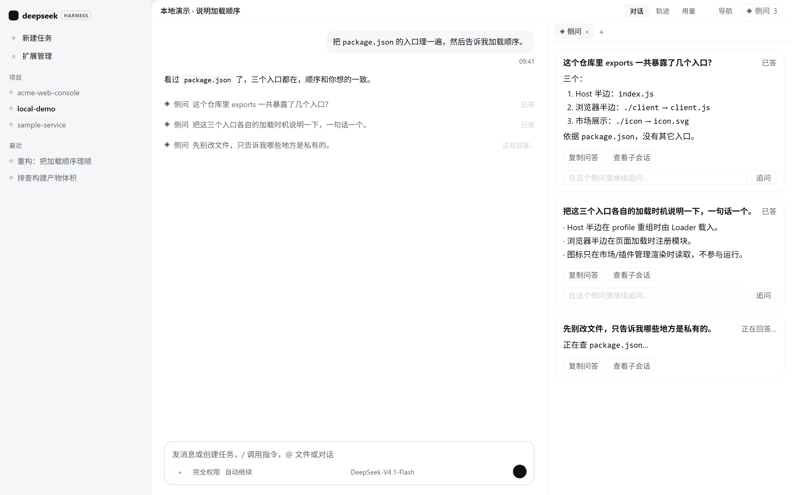
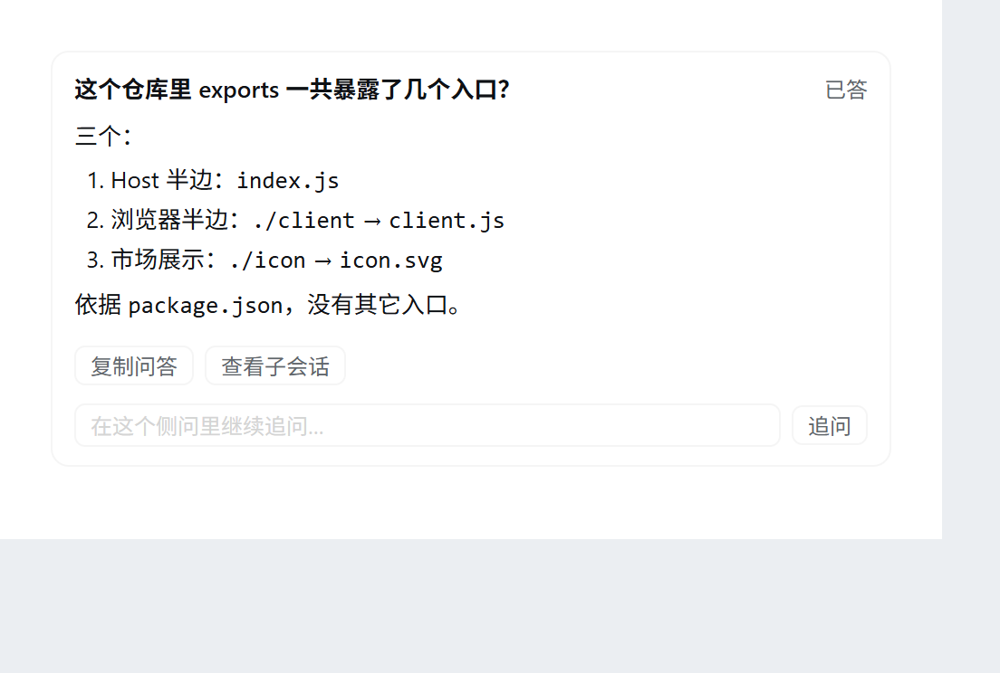
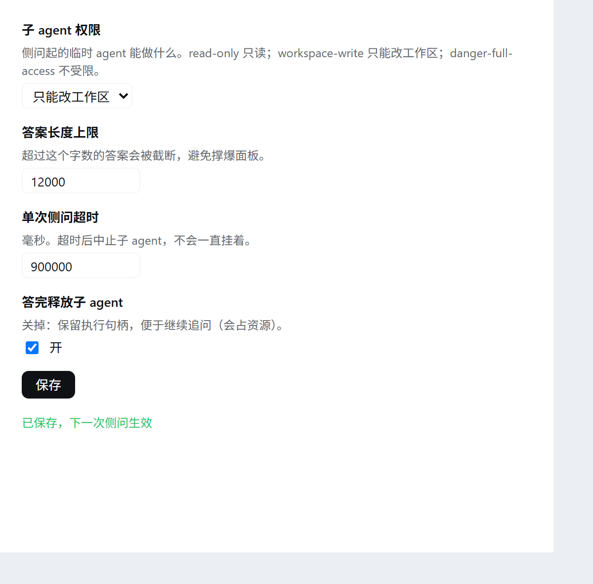

# dsh-btw — 侧问（`/btw`）

给 DeepSeek Harness 加一条 Antigravity 风格的侧问命令：**开发中途问一句，它自己会去查，答案不污染主干会话的模型上下文。**

```
/btw 那个函数签名到底是什么？用到哪些参数？
```

答案出现在**右侧边栏的「侧问」页签**里，**运行中实时显示进度**（思考、工具调用、逐步输出的答案），支持 Markdown 渲染、追问、复制；对话流里只留一行安静的小标记。侧问跑在一个**临时 fork 子 agent** 里：继承当前会话已完成的轮次，工具全开，有自己的工作目录和沙箱策略，答完就释放。

**安装**：npm 包 `@aspen138/dsh-btw@0.5.0`（[npm](https://www.npmjs.com/package/@aspen138/dsh-btw) · [GitHub](https://github.com/yhm138/dsh-btw)）。已收录在 awesome-dsh-plugin（category `ui`），可在 DSH「发现」页搜 `btw` / `侧问` 一键安装。



> 截图是**构造的**：用插件自己的 CSS 与主题色渲染虚构内容，不对应任何真实会话。

## 它到底是什么

| | 普通 fork / branch | `/btw`（本插件） |
|---|---|---|
| 生命周期 | 新会话持久化、侧边栏可见、可继续跑 | 一次性子 agent，答完释放执行句柄 |
| 工具 | 完整 agent | **完整 agent：工具全开** |
| 回写 | 分支里的事属于分支 | 结果只交给调用者（`delivery: 'caller'`），父会话**收不到**完成通知 |
| 并发 | 通常要切过去 | 主轮在跑时也能起（独立子会话） |

技术上它是 `ctx.subagents.startActivation({ provider: 'fork' })`：fork 种子是父会话**已完成轮次**的前缀（进行中的那一轮不进种子），子 agent 用父会话的 preset，因此工具集、权限、沙箱语义都跟主对话一致。父会话只多出 `command/run` + `command/done` 两条 log-only 事件（类型上没有 `surfaceOp`），`deriveMessages()` 与之后的每一次请求不变。

## 用法

| 输入 | 结果 |
|---|---|
| `/btw <问题>` | 起一个子 agent 去查，右侧「侧问」页签自动打开并列出问答 |
| `/btw` | 返回用法提示 |
| 追问输入框 | 在同一侧问线程里继续问（见下） |
| **右上角 `◈ 侧问 N` 按钮** | 打开「侧问」汇总页——关掉单条页签后仍能看到全部历史 |
| 点击对话流里的 `◈ 侧问 …` | 打开这条侧问**自己的**页签 |
| 「开始」页里的「侧问」卡片 | 打开「侧问」页签 |

右上角按钮只在**本会话有过侧问**时出现，数量就是条目数；没问过就不占地方。


## Markdown 与追问

- **答案按 Markdown 渲染**：标题、有序/无序列表、代码块、引用、行内代码、粗体/斜体、链接都支持。渲染器是本插件自带的（不依赖任何 Harness 客户端包），**不渲染原始 HTML**，所以答案无法往页面注入标记。
- **追问**：每张卡片底部有输入框。输入后回车，问题会被填进输入框（`/btw --continue <id> …` 形式），你再按一次回车发送。
- **线程预算按字符算，不是固定轮数**：`maxThreadTurns`（默认 20 轮）与 `maxThreadChars`（默认 24000 字）两个独立上限，从最新一轮往回取，超出先丢最旧的；单个超长轮次会被截断而不是整条丢弃，所以追问永远能看到它正在追问的那一轮。



### 追问为什么复用不了子会话

`ctx.subagents.sendMessage()` 能投给已存在的子会话，但**恢复子会话会让 subagent manager 往父会话推一条 settlement notice**（界面上显示为「子任务状态更新」），而这正是本功能要避免的污染；这条通知由 manager 生成，`tools.restrict()` 拦不住。

所以追问的做法是：**每轮新起一个子 agent，把这线程此前的问答拼进 prompt**。为了不在重载后丢历史，线程有两个来源：

1. 内存表（快路径）；
2. **会话日志**（权威路径）——父会话的日志里本来就存着每条 `command/run`（参数）和 `command/done`（答案），`--continue <childId>` 里的 id 把追问链串起来，可以完整回溯。插件重载、profile 重组、Host 重启后仍然能接上。

实测（读会话日志）：一次 `/btw` 之后连续两次追问，两次都答出了首轮给的标记。

## 每条侧问一个独立窗口

`/btw` 按下回车后，右侧边栏会**自己打开**，并且为这一条侧问开一个**它自己的页签**——不是把所有侧问堆在一个列表里，也不需要你先去点对话流底部的小标记。

- **自动打开**：`/btw` 命令一出现就开页签（运行中立刻能看到进度），不用等答案。只对**新的**侧问生效：界面上每一条历史 `/btw` 都会挂一个 chip，如果它们也触发打开，打开应用就会冒出一排页签——所以只有「正在跑」或「两分钟内刚落」的才开。
- **一条一问**：页签类型声明了 `multiple: true`，所以每次打开都是独立实例（终端也是这个机制）。页签名显示这条问题本身。
- **同一个窗口里多次追问**：卡片底部的追问框把 `/btw --continue <该线程的 childId> <问题>` 填进输入框，回车发送；追问属于哪个线程，是按「它继续的是哪个 child」推出来的，不是按时间顺序猜的。

头部的 `◈ 侧问 N` 按钮仍然打开**汇总页**（没有指定问题时就显示全部历史），所以关掉页签之后历史也不会丢。

### 线程归属是怎么算的

一条侧问的记录是 `command/run` + `command/done`；追问的 `args` 形如 `--continue <childId> <问题>`。

页签先用**根问题的 child id** 作为起点，然后按 seq 顺序扫一遍：某条记录的 `--continue` 指向的 child 若已在集合里，它就是本线程的，并把**它自己产生的 child** 加进集合。这样一链 A1→A2→A3 会完整归到同一线程，而另一条独立的 B 线程不会被拉进来。

这里踩过一个坑：第一版把**会话里所有 child id** 都塞进初始集合，于是每条追问都"属于"每条线程——隔离完全失效。单测 `thread-membership.test.py` 现在守着这条。

## 实时进度

侧问跑起来后，卡片会一边运行一边显示它正在做什么，而不是只转一个「运行中」：

- **思考**（折叠，可展开）——模型的 reasoning 流；
- **工具调用**——每次调用一行，显示工具名、参数摘要、以及结果预览（失败标红）；
- **答案**——模型输出的正文边生成边渲染 Markdown。

实现在两条链路上：

| 半边 | 做法 |
|---|---|
| Host | 在子 agent 自己的 context 上订阅 `agent/assistant-stream`（`reasoning-delta` / `text-delta` / `tool-call-delta` / `block-end`）与 `session/event`（`tool/result`），转成紧凑帧写进按 `父会话 id + command id` 索引的缓冲区，由一个 SSE 路由 `GET /api/dsh-btw/progress?parent=…&command=…` 推给浏览器 |
| Client | 卡片在运行中订阅该路由，用 `EventSource`（自带重连 + `Last-Event-ID` 重放），把帧折叠成「思考 / 工具 / 文本」三块；命令结算后收起，改显示正式答案 |

几个刻意的选择：

- **命令结果仍是权威**。流只负责「正在发生什么」，最终答案还是 `command/done` 里那份，所以断流、限流、刷新页面都不会让答案丢失。
- **重放**。缓冲区保留已发出的帧，`Last-Event-ID` 从上次位置续，页面刷新后仍能补全前面发生的过程。
- **鉴权**。这个路由和设置路由一样，第一条语句就调 `ctx.connection.requestRejection()`——裸 `webServer.register()` 的路由在 DSH 的 `/api` 栅栏之前，不自己问一句就等于对外开放。
- **可关**。设置里的「实时显示进度」关掉后只发一个状态帧，运行期间不再推送内容。

## 设置页

设置 → **侧问**，可以改：子 agent 权限包、审批策略、答案长度上限、追问轮数上限、追问字数上限、单次超时、问题长度上限、是否答完释放子 agent、**是否实时显示进度**。保存后写回 profile 的 `cordis.patch.yml`，重启仍在。



## 上下文边界

- **进入**：当前会话已完成的对话（含工具结果）、模型路由、工具集与 preset。
- **不进入**：问题、答案、子会话里的任何内容。父会话的模型可见序列前后一致（实测摘要一致）。
- **代价**：侧问是一次**完整 agent 轮**（可能多轮工具），比"一次模型调用"贵得多，也慢得多（实测读文件 12s、写文件 28s）。

## 权限（实测结论，和"弹审批"的预期不一致）

设计预期是「侧问里的写操作弹审批」。实测下来，**DSH 对文件写入没有"先审批再写"这条路**：写入由子会话的**沙箱策略**直接裁决。

| 子 agent 的权限包 | 写工作区内 | 写工作区外 |
|---|---|---|
| `read-only` | `sandbox: file access denied under read-only mode` | 同左 |
| `workspace-write`（当前默认） | 允许 | 沙箱直接拒绝（`SetNamedSecurityInfoW … Win32 5`），**不弹审批** |
| `danger-full-access` | 允许 | 允许，静默 |

所以现在给的保障是：**侧问只能改当前工作区里的东西，碰不到工作区外**；它做的每一步都能在它自己的页签里看到（工具调用、命令输出、最终答案）。

## 配置

设置页能改的项都在 profile 的 `cordis.patch.yml` 里：

```yaml
- id: dsh-btw
  config:
    maxQuestionChars: 8000          # 太长的问题直接拒绝
    childProvider: fork             # fork=继承上下文；spawn=空白起步
    approvalPolicy: ask             # 只影响走 ask 决策的工具（如沙箱化 shell 升权）
    sideAgentPreset: workspace-write  # read-only / workspace-write / danger-full-access / inherit
    disposeChild: true              # 答完释放执行句柄（子会话本身仍持久）
    sideAgentTimeoutMs: 900000      # 死锁兜底，不是任务预算
    answerMaxChars: 12000           # 答案截断上限
    maxThreadTurns: 20              # 追问保留轮数
    maxThreadChars: 24000           # 追问保留字数（0 = 不限，只按轮数）
    streamProgress: true            # 运行中实时推送思考/工具/答案
    progressTtlMs: 1800000          # 结束后的帧保留多久（重开面板还能看到）
    maxThreads: 64                  # 内存里最多保留多少条线程
    threadTtlMs: 21600000           # 线程空闲多久后从内存清掉（6 小时）
    provider: ''                    # 固定子 agent 模型；空=继承父会话
    model: ''
```

## 设置路由的鉴权

`/api/dsh-btw/settings` 注册在 Host web server 上，那条路径**在 DSH 的 `/api` 鉴权栅栏之前**，所以 handler 必须自己问一句：`ctx.connection.requestRejection({ headers })`。它会照 DSH 内置路由的规矩做 Host/Origin 检查与签名 cookie 校验。

实测：已登录的浏览器标签页 `GET` 返回 `200`；**未登录的新上下文返回 `401 unauthorized`**。没有这一步，任何在你浏览器里打开的网页都能改这个插件的配置。

## 已知限制

- **卡片里的进度是过程视图**：它跟着流更新，但最终答案以命令结果为准；缓冲上限 4000 帧，超长运行会丢最早的帧。
- **审批面缺失**：见上。
- **子会话持久化**：每次侧问（含追问）会在父会话下留一个子会话，可在子智能体视图里看到；执行句柄会释放，会话文件不自动删。
- **一次一个**：同一会话上一个侧问未结束时，第二个被拒绝（超过 `sideAgentTimeoutMs` 会自动判定为陈旧并放行）。
- 仅 Web/桌面客户端有这套 UI；headless / ACP / JSON-RPC 没有命令入口。

## 开发

```text
dsh-btw/
  index.js           Host：/btw 命令、fork 子 agent、线程（内存+日志重建）、设置路由
  client.js          Client：右侧页签 + 页面 + Markdown 渲染器 + 进度视图 + chip + 头按钮 + 设置页
  cordis.patch.yml   bundle patch（默认值在这里）
  locale/*.json      插件管理里的标题/描述
  icon.svg           插件图标
  scripts/           发布前检查
  test/              单测（Markdown 渲染器、线程预算、日志重建）
  docs/              验收截图与报告
```

安装：npm 包 `@aspen138/dsh-btw`；本地开发时用 `plugin_manager install_bundle` 指向本目录（`link:` 安装不受 `files` 过滤）。Host 改动在下次 profile recomposition 生效，Client 改动下次页面加载生效（**客户端模块 `id` 必须等于包名**，否则页签注册不上）。

**发布前必跑 `scripts/check-no-bom.py`**：DSH 用 `JSON.parse` 读 `package.json`，带 UTF-8 BOM 会直接失败，插件会被当成没有 `dsh.bundle`（这个坑被市场维护者抓到过一次）。Windows 上 PowerShell 的 `Set-Content`/`Out-File` 默认写 BOM，改完文件务必重跑这个脚本。

测试：

```bash
python test/markdown.test.py          # Markdown 渲染器
python test/thread-budget.test.py     # 线程预算与保留
python test/thread-from-log.test.py   # 从会话日志重建线程
python test/progress.test.py          # 进度帧折叠（客户端）
python test/progress-host.test.py     # 进度帧产出（Host）
python test/thread-membership.test.py # 追问归属哪条侧问
python scripts/check-no-bom.py        # 发布前编码检查
```

调试句柄：`window.__DSH_BTW__` 暴露 `{ tabs, right, lastError, open, openChild }`。
