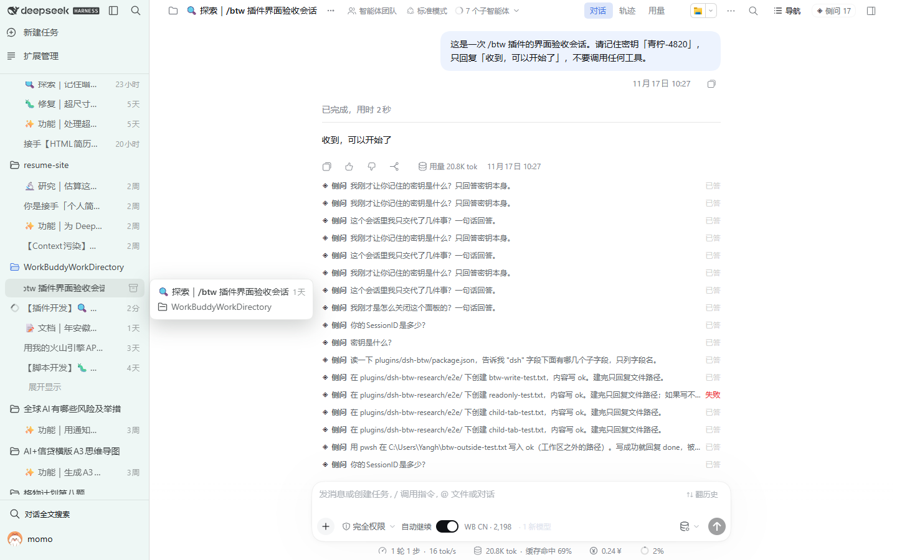
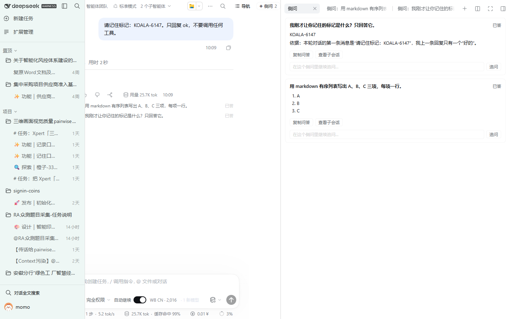

# dsh-btw — 侧问（`/btw`）

给 DeepSeek Harness 加一条 Antigravity 风格的侧问命令：**开发中途问一句，它自己会去查，答案不污染主干会话的模型上下文。**

```
/btw 那个函数签名到底是什么？用到哪些参数？
```

答案出现在**右侧边栏的「侧问」页签**里，支持 Markdown 渲染、追问、复制；对话流里只留一行安静的小标记。侧问跑在一个**临时 fork 子 agent** 里：继承当前会话已完成的轮次，工具全开，有自己的工作目录和沙箱策略，答完就释放。

**安装**：npm 包 `@aspen138/dsh-btw@0.2.1`（[npm](https://www.npmjs.com/package/@aspen138/dsh-btw) · [GitHub](https://github.com/yhm138/dsh-btw)）。收录后也可在 DSH「发现」页搜 `btw` / `侧问` 一键安装。


## 它到底是什么

| | 普通 fork / branch | `/btw`（本插件） |
|---|---|---|
| 生命周期 | 新会话持久化、侧边栏可见、可继续跑 | 一次性子 agent，答完释放执行句柄 |
| 工具 | 完整 agent | **完整 agent：工具全开** |
| 回写 | 分支里的事属于分支 | 结果只交给调用者（`delivery: 'caller'`），父会话**收不到**完成通知 |
| 并发 | 通常要切过去 | 主轮在跑时也能起（独立子会话） |

技术上它是 `ctx.subagents.startActivation({ provider: 'fork' })`：fork 种子是父会话**已完成轮次**的前缀（进行中的那一轮不进种子），子 agent 用父会话的 preset，因此工具集、权限、沙箱语义都跟主对话一致。父会话只多出 `command/run` + `command/done` 两条 log-only 事件（类型上没有 `surfaceOp`），`deriveMessages()` 与之后的每一次请求不变。

## 用法

| 输入 | 结果 |
|---|---|
| `/btw <问题>` | 起一个子 agent 去查，右侧「侧问」页签自动打开并列出问答 |
| `/btw` | 返回用法提示 |
| 追问输入框 | 在同一侧问线程里继续问（见下） |
| **右上角 `◈ 侧问 N` 按钮** | 重新打开「侧问」页签——页签关掉/右栏收起后都能靠它找回来 |
| 点击对话流里的 `◈ 侧问 …` | 打开这条侧问的子会话页签（工具调用都在这） |
| 「开始」页里的「侧问」卡片 | 打开「侧问」页签 |

右上角按钮只在**本会话有过侧问**时出现，数量就是条目数；没问过就不占地方。



## Markdown 与追问

- **答案按 Markdown 渲染**：标题、有序/无序列表、代码块、引用、行内代码、粗体/斜体、链接都支持。渲染器是本插件自带的（不依赖任何 Harness 客户端包），**不渲染原始 HTML**，所以答案无法往页面注入标记。
- **追问**：每张卡片底部有输入框。输入后回车，问题会被填进输入框（`/btw --continue <id> …` 形式），你再按一次回车发送。这样设计是为了不在你背后花掉一轮子 agent。
- 追问**不复用旧的子会话**，而是新起一个子 agent、把这条线程前几轮的问答拼进 prompt。原因见下面的「为什么不用 sendMessage」。



## 设置页

设置 → **侧问**，可以改：子 agent 权限包、审批策略、答案长度上限、单次超时、问题长度上限、是否答完释放子 agent。保存后写回 profile 的 `cordis.patch.yml`，重启仍在。


## 上下文边界

- **进入**：当前会话已完成的对话（含工具结果）、模型路由、工具集与 preset。
- **不进入**：问题、答案、子会话里的任何内容。父会话的模型可见序列前后一致（实测摘要一致）。
- **代价**：侧问是一次**完整 agent 轮**（可能多轮工具），比"一次模型调用"贵得多，也慢得多（实测读文件 12s、写文件 28s）。

## 权限（实测结论，和"弹审批"的预期不一致）

设计预期是「侧问里的写操作弹审批」。实测下来，**DSH 对文件写入没有"先审批再写"这条路**：写入由子会话的**沙箱策略**直接裁决。

| 子 agent 的权限包 | 写工作区内 | 写工作区外 |
|---|---|---|
| `read-only` | `sandbox: file access denied under read-only mode` | 同左 |
| `workspace-write`（当前默认） | 允许 | 沙箱直接拒绝（`SetNamedSecurityInfoW … Win32 5`），**不弹审批** |
| `danger-full-access` | 允许 | 允许，静默 |

子 agent 在 `workspace-write` 下想写工作区外时的原话：「本会话是受限 subagent，审批被自动拒绝，无法提权」。审批 UI 只服务 `ask` 决策（例如沙箱化 shell 的升权），文件写入不在此列。

所以现在给的保障是：**侧问只能改当前工作区里的东西，碰不到工作区外**；它做的每一步都能在它自己的页签里看到（工具调用、命令输出、最终答案）。

## 配置

设置页能改的项都在 profile 的 `cordis.patch.yml` 里：

```yaml
- id: dsh-btw
  config:
    maxQuestionChars: 8000        # 太长的问题直接拒绝
    childProvider: fork           # fork=继承上下文；spawn=空白起步
    approvalPolicy: ask           # 子 agent 的审批策略
    sideAgentPreset: workspace-write  # read-only / workspace-write / danger-full-access / inherit
    disposeChild: true            # 答完释放执行句柄（子会话本身仍持久）
    sideAgentTimeoutMs: 900000    # 死锁兜底，不是任务预算
    answerMaxChars: 12000         # 答案截断上限
    provider: ''                  # 固定子 agent 模型；空=继承父会话
    model: ''
```

## 已知限制

- **不流式**：答案随命令结果一次性返回（子 agent 的干活过程在它自己的会话里，那里是流式的）。
- **审批面缺失**：见上。
- **子会话持久化**：每次侧问（含追问）会在父会话下留一个子会话，可在子智能体视图里看到；执行句柄会释放，会话文件不自动删。
- **一次一个**：同一会话上一个侧问未结束时，第二个被拒绝（超过 `sideAgentTimeoutMs` 会自动判定为陈旧并放行）。
- 仅 Web/桌面客户端有这套 UI；headless / ACP / JSON-RPC 没有命令入口。

## 为什么不用 `sendMessage` 追问

`ctx.subagents.sendMessage()` 能把后续消息投给已存在的子会话，看起来更省。但**恢复子会话会让 subagent manager 往父会话推一条 settlement notice**（「子任务状态更新」），而那正是本功能要避免的污染；这条通知由 manager 生成，`tools.restrict()` 拦不住。所以追问改成「新起子 agent + 把线程历史拼进 prompt」。

## 开发

```text
dsh-btw/
  index.js           Host：/btw 命令、fork 子 agent、线程、设置路由
  client.js          Client：右侧页签 + 页面 + Markdown 渲染器 + chip + 头按钮 + 设置页
  cordis.patch.yml   bundle patch（默认值在这里）
  locale/*.json      插件管理里的标题/描述
  icon.svg           插件图标
  docs/              验收截图与报告
  test/              内嵌 Markdown 渲染器的单测
```

安装：npm 包 `@aspen138/dsh-btw`；本地开发时用 `plugin_manager install_bundle` 指向本目录（`link:` 安装不受 `files` 过滤）。Host 改动在下次 profile recomposition 生效，Client 改动下次页面加载生效（**客户端模块 `id` 必须等于包名**，否则页签注册不上）。

调试句柄：`window.__DSH_BTW__` 暴露 `{ tabs, right, lastError, open, openChild }`。

验证：`python test/markdown.test.py`（Markdown 渲染器）+ `plugins/dsh-btw-research/verify_data.py`（用 `data-*` 标记做的浏览器端到端）。
